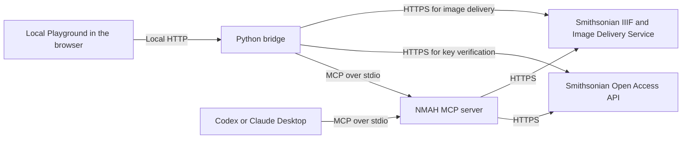

# NMAH Military Collection MCP

An independent, read-only Model Context Protocol (MCP) server and local Playground
for exploring the Armed Forces History collections at the
[National Museum of American History (NMAH)](https://americanhistory.si.edu/collections).
Search catalog records, retrieve full object metadata, and check image sources
and usage rights through Smithsonian Open Access.

## Quick Start

Install Python 3.13 or newer and [uv](https://docs.astral.sh/uv/). Clone the
repository and start the Playground:

```sh
git clone https://github.com/yixuan-liu/nmah-military-collection-mcp.git
cd nmah-military-collection-mcp
uv run --locked python playground/server.py
```

1. Open the local URL printed in the terminal.
2. Select **Set API key**, enter your Smithsonian Open Access key, and choose
   **Verify and apply**. After the first successful verification, choose
   **Continue to search**. Get a key from the
   [Smithsonian EDAN signup form](https://edan.si.edu/openaccess/signup/form/).
   Tool schemas are available before you configure a key.
3. Search for `nmah_446333` and select **Inspect**. Choose **Metadata** or
   **Image assets** and press Enter to run the selected lookup. Try both modes
   with the same record ID to compare the results.

If you keep a key in the project's ignored `.env`, start the Playground with:

```sh
uv run --locked --env-file .env python playground/server.py
```

## MCP tools

| Tool | What it does |
| --- | --- |
| `search_nmah_military_objects` | Search the NMAH Armed Forces History collection scope by keyword, with optional branch, decade, and image filters. Results include pagination information. |
| `get_nmah_military_object_metadata` | Verify the collection scope and return the full Smithsonian record for an NMAH record ID. |
| `get_nmah_military_object_image_assets` | List available Open Access JPEG and TIFF resources and IIIF images, with dimensions and usage information where supplied. |

See the [tool reference](#tool-reference) for parameters and examples.

## Local Playground

- Search the collection and page through results. Use **Inspect** to carry an
  NMAH record ID into the record lookup.
- Review metadata and image resources in separate panels. Open IIIF images in a
  new tab or choose an available Open Access JPEG or TIFF from the preview dialog.
- View tool schemas, applied search filters, and raw JSON responses. Copy a
  request ID to find the corresponding Playground and MCP logs.

The Playground listens on loopback. A key verified in the browser stays in
memory for that local process and is shared across its tabs. **Use project
default** restores the key loaded when the Playground started. If no key was
loaded at startup, the Playground returns to an unconfigured state. Press
Ctrl+C in the terminal to stop the process.

## Setup and startup

To use the MCP server from a client, install the locked dependencies and set
`SMITHSONIAN_API_KEY` in the project's ignored `.env`. If a `.env` already
exists, use that file.

```sh
uv sync --locked
cp -n .env.example .env
```

The [environment template](.env.example) lists the supported variables. The
MCP server authenticates upstream requests with the `X-Api-Key` header.

### Connect an MCP client

After `uv sync --locked`, keep your key in the clone's ignored `.env`. In the
examples below, replace both paths with absolute paths to your copy of `uv` and
your clone. Merge the server entry into your existing client configuration.

**Codex** (`~/.codex/config.toml`)

```toml
[mcp_servers.nmah-military-collection]
command = "/absolute/path/to/uv"
args = ["run", "--locked", "--directory", "/absolute/path/to/nmah-military-collection-mcp", "--env-file", ".env", "python", "-m", "nmah_military_collection_mcp"]
```

**Claude Desktop** (`claude_desktop_config.json`)

```json
{
  "mcpServers": {
    "nmah-military-collection": {
      "command": "/absolute/path/to/uv",
      "args": [
        "run",
        "--locked",
        "--directory",
        "/absolute/path/to/nmah-military-collection-mcp",
        "--env-file",
        ".env",
        "python",
        "-m",
        "nmah_military_collection_mcp"
      ]
    }
  }
}
```

Restart the client. In Codex, use `codex mcp list` to confirm registration.
Then check tool discovery and ask the client to find `nmah_446333` with
`search_nmah_military_objects`.

### Logging

Set `LOG_LEVEL=INFO` in the root `.env` to control application logs for both
the MCP server and the Playground. Use either startup command with
`--env-file .env`, and restart after changing the value. If an MCP client
starts the server, use that same launch option or supply `LOG_LEVEL` in
the client's environment. The Playground forwards the setting to its MCP
subprocess.

`INFO` is the default for unset, blank, or invalid values. Use `DEBUG` for
upstream request timing and pagination details, or `WARNING`, `ERROR`, or
`CRITICAL` for quieter output. Application logs go to stderr. MCP stdout
carries protocol messages. Set `FASTMCP_LOG_LEVEL` separately to change
FastMCP framework logging. Application logs omit credentials, request
headers, search text, full request URLs, and response bodies.

## Tool reference

### Search objects

| Parameter | Default | Behavior |
| --- | --- | --- |
| `query` | Empty string | Keyword expression. Empty or whitespace-only input becomes `q=*`. |
| `branch` | `null` | Army, Navy, Air Force, Marine Corps, or Coast Guard. |
| `rows` | `10` | Page size from 1 to 50. |
| `offset` | `0` | Non-negative starting position, passed as API `start`. |
| `date` | `null` | One decade label from `1770s` through `2000s`. |
| `has_images` | `false` | When true, adds `online_media_type:Images`; image URLs and CC0 rights are not guaranteed. |

```json
{
  "query": "cap",
  "branch": "Army",
  "date": "1910s",
  "has_images": true,
  "rows": 10,
  "offset": 0
}
```

Object names, models, people, and other descriptive terms go in `query`.
The fixed `fqs` include `unit_code:NMAH`, `type:edanmdm`, and the escaped
`Military and Society: Armed Forces History` set-name prefix. Filters are sent
as a JSON array encoded into the API's `fqs` parameter. Sorting uses `id`.

Branch matching checks `title` and `object_type`, ignoring case. The aliases
`USA`, `USN`, `USAF`, `USAAF`, `USMC`, `USCG`, `WAC`, `WAAC`, `USNR`,
`U.S.N.`, `U.S.C.G.`, `U.S.M.C.`, and `Marine` require boundaries at field edges
or characters outside ASCII letters, digits, and underscore. Dots in aliases
are matched literally. Other aliases use substring matching. Army also includes
`Military Academy`. Navy also includes `Naval Academy`, `Midshipman`, and
`Naval Reserve`. Air Force also includes `Army Air Forces` and `Air Corps`. These are overlapping research groups. Preserve historical names
and verify attribution against the original record.

Date filtering matches the catalog's indexed decade labels. A record can have
multiple labels, and the indexed date may describe an association rather than
manufacture. Image indexing can exist without an image URL in the API response.

### Retrieve object metadata

Call `get_nmah_military_object_metadata` with a bare NMAH record ID:

```json
{
  "record_id": "nmah_463569"
}
```

Use `content.descriptiveNonRepeating.record_ID` from a search result. This
required string accepts `nmah_` followed by digits (maximum 64 characters),
not the top-level row ID, a catalog number, or a URL.

The tool requests `/content/edanmdm%3A{record_id}` with header authentication.
It checks the returned record ID, NMAH unit codes, `edanmdm` type, and an
Armed Forces History set-name prefix before returning the entire API
`response` record unchanged. This includes the `content` metadata and all
other record fields; the API transport envelope is not included.
Out-of-scope, missing, or unverifiable records return a tool error.
No image filter is applied. Image URLs may be absent; no IIIF fallback,
summary, or rights inference is added.

### List image assets

Call `get_nmah_military_object_image_assets` with a bare `record_id`, such as
`nmah_446333` or `nmah_463569`. The tool verifies the same collection scope as
metadata retrieval. It lists high-resolution Open Access JPEG and TIFF resources
first and checks the public Smithsonian IIIF Presentation 2 manifest for matching
or additional views. It groups resources by media ID when one can be established.
Dimensions describe the listed resource and come from its source.

The `media_access` field preserves the individual image's Open Access
`usage.access` value or `null` when unavailable. The `usage_label` is `CC0`
only when the image's own access value is `CC0`. All other values display
`Usage Conditions Apply`. The manifest license URL is reported separately.

| Status | Meaning |
| --- | --- |
| `resolved` | Source checks completed and found at least one resource. |
| `partial` | A source could not be checked fully. The tool returns any resources already found and explains the gap in `warnings`. |
| `no_assets` | Source checks completed without finding a supported resource. |

In the Playground, use **View image** to choose an available Open Access JPEG or
TIFF, or to open an IIIF image in a new tab.

## Results and pagination

The search response contains `total_count`, `returned`, `offset`, `next_offset`, the
applied query and filters, selected options, candidate aliases, and raw API
records in `objects`. Candidate aliases describe the search configuration.

Keep the same search arguments and use `next_offset` for the next call when it
is set. If `next_offset` is `null`, compare `offset + returned` with
`total_count`. A value at or beyond `total_count` indicates the end of the
reported results. If `returned` is zero and `offset < total_count`, treat
the empty page as an upstream anomaly and the results as incomplete. Offset
pagination reflects the current upstream index.

## Architecture

The browser uses local HTTP to reach the Python bridge. The bridge calls the
MCP server over stdio. Codex and Claude Desktop can launch the same MCP server
directly using the [client configuration](#connect-an-mcp-client).



The installed MCP package lives under `src/nmah_military_collection_mcp/`.
The Playground uses native JavaScript modules served by the Python bridge.
See the [architecture guide](docs/en/architecture.md) for the tool call flows.

| Module | Responsibility |
| --- | --- |
| `app.py`, `context.py` | Register tools and manage one shared HTTP client per server lifespan. |
| `tools.py` | Define the MCP interface and orchestrate search and metadata retrieval. |
| `query.py`, `scope.py` | Build the search request and verify collection membership on retrieved records. |
| `api_client.py`, `config.py` | Read credentials on demand, send requests, and validate response envelopes. |
| `models.py`, `errors.py` | Share search types and report failures across modules. |

Tool discovery works without an API key.

## Verification

Run the local checks from the project root after `uv sync --locked`.

```sh
uv run --locked fastmcp inspect src/nmah_military_collection_mcp/server.py --format mcp
uv run --locked ruff check src tests playground
uv run --locked ruff format --check src tests playground
uv run --locked python -m unittest discover -s tests
uv run --locked python tests/smoke.py
```

Ruff checks Python files under `src/`, `tests/`, and `playground/`. To apply safe lint fixes,
including import sorting, and format the files, run:

```sh
uv run --locked ruff check --fix src tests playground
uv run --locked ruff format src tests playground
```

Run the live comparison separately with a Smithsonian API key:

```sh
uv run --locked --env-file .env python tests/smoke.py --live
```

The unit tests check alias matching, HTTP requests with an injected mock
transport, connection cleanup, and metadata scope and failure handling.
The metadata fixture is a copy of the saved
[Smithsonian content response](docs/evidence/image-filter-validation-2026-11-08/nmah_463569-content.json).
The stdio smoke check verifies discovery, schemas, instructions, and input
validation. Live mode compares search rows and counts and the complete
metadata record with direct Open Access API responses. It also checks the image
tool against an Open Access JPEG case and an IIIF fallback case.

## Documentation

- **Project guides** · [English](docs/en/README.md) and [中文](docs/zh/README.md). Both indexes cover architecture, search, images, logging, and verification.
- **Smithsonian API reference** · [Official Open Access documentation](https://edan.si.edu/openaccess/apidocs/) and [unofficial Swagger UI](docs/en/swagger-ui.md).

## License

Original project code and documentation are available under the [MIT License](LICENSE).
See [third-party notices](THIRD_PARTY_NOTICES.md) for Swagger UI and Smithsonian materials.
