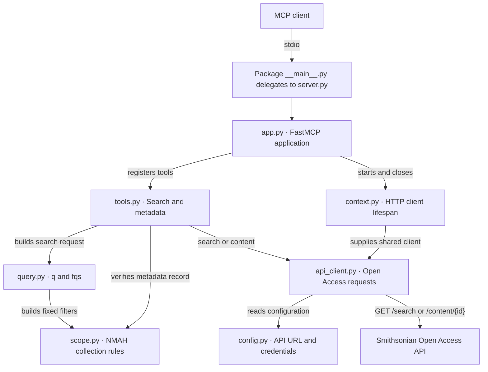

# NMAH MCP module architecture and refactor verification

[中文版](../zh/architecture.md) · [README](../../README.md)

## Module architecture

MCP clients call the search and single-record metadata tools over stdio. The project uses a `src` layout. After installation, run `python -m nmah_military_collection_mcp`. The packaged [server.py](../../src/nmah_military_collection_mcp/server.py) provides the launcher and exposes the app to FastMCP Inspect.



| Module | Responsibility |
| --- | --- |
| [app.py](../../src/nmah_military_collection_mcp/app.py) | Creates the FastMCP application, sets server instructions, and registers both tools. |
| [context.py](../../src/nmah_military_collection_mcp/context.py) | Opens one shared HTTP client per application lifespan and closes it at shutdown. |
| [tools.py](../../src/nmah_military_collection_mcp/tools.py) | Defines the tool contracts, coordinates calls, and translates internal exceptions to tool errors. |
| [query.py](../../src/nmah_military_collection_mcp/query.py) | Builds the search request from keywords, branch, decade, and image options. |
| [scope.py](../../src/nmah_military_collection_mcp/scope.py) | Defines the museum, record type, and set-name prefix used for search filters and metadata checks. |
| [api_client.py](../../src/nmah_military_collection_mcp/api_client.py) and [config.py](../../src/nmah_military_collection_mcp/config.py) | Encode requests, read the key from the environment on demand, authenticate through `X-Api-Key`, and validate HTTP and API responses. |
| [models.py](../../src/nmah_military_collection_mcp/models.py) and [errors.py](../../src/nmah_military_collection_mcp/errors.py) | Define parameter types, internal search requests and pages, and API and scope errors. |

## Search flow

Call `search_nmah_military_objects` with keywords and filters. The following input was used for the first page in live verification.

```json
{
  "branch": "Army",
  "date": "1910s",
  "has_images": true,
  "rows": 3,
  "offset": 0
}
```

1. The tool validates its inputs. `query.py` maps a blank keyword to `q=*`. The fixed `fqs` include `unit_code:NMAH`, `type:edanmdm`, and the `Military and Society: Armed Forces History` set-name prefix. Branch aliases, the indexed decade, and `online_media_type:Images` are added according to the options.
2. The API client serializes the filters as one JSON array string and sends `GET /search` with `rows`, `start=offset`, and `sort=id`.
3. The tool exposes the API's `rowCount` and original `rows` as `total_count` and `objects`, with `applied_query`, `applied_filters`, pagination fields, and search options. Use `next_offset` as `offset` with the same arguments for the next page. On the last page, `next_offset` is `null`.

## Metadata flow

Call `get_nmah_military_object_metadata` with `content.descriptiveNonRepeating.record_ID` from a search record.

```json
{
  "record_id": "nmah_463569"
}
```

1. The tool validates the `nmah_<digits>` identifier. The API client encodes `edanmdm:<record_id>` as a path segment and calls `GET /content/{id}`.
2. After the HTTP and API status checks, `scope.py` verifies the returned identifier, the outer `unitCode` and inner `unit_code`, the `edanmdm` type, and at least one `freetext.setName[].content` value beginning with the Armed Forces History prefix.
3. The tool returns the complete API `response` record after verification. Missing, out-of-scope, and unverifiable records produce tool errors. Image filtering applies to search, and metadata reflects the museum response. See the [image filter and media verification](smithsonian-api-and-media.md).

## Verification results

These checks were recorded during refactor verification on **2026-11-08**. Hit counts depend on the museum's index.

| Check | Result |
| --- | --- |
| stdio compatibility | Tool discovery through the two entry points used during refactor verification matched the pre-refactor snapshot, including both names, input and output schemas, annotations, and server instructions. FastMCP Inspect passed. |
| Offline tests | Three tests passed, covering branch aliases, search parameters, shared-client cleanup, metadata scope, and upstream failures. The stdio smoke check passed nine invalid-input cases and verified discovery and call behavior without a key. |
| Live search | The Army, 1910s, image-indexed query with `q=*` matched **2,535** records. Two pages at offsets 0 and 3 yielded six distinct records. The total, record contents, and ordering matched direct API calls, and the combined pages matched a single six-row request. The image-filtered lookup of `nmah_400783` also passed. |
| Live metadata | `nmah_463569` passed the scope checks. The full MCP record matched the direct `/content` response record field for field. |

Run these commands from the project root. The live test reads `SMITHSONIAN_API_KEY` from `.env`.

```sh
uv run --locked fastmcp inspect src/nmah_military_collection_mcp/server.py --format mcp
uv run --locked python -m unittest discover -s tests
uv run --locked python tests/smoke.py
uv run --locked --env-file .env python tests/smoke.py --live
```

See [tests/smoke.py](../../tests/smoke.py) and [tests](../../tests) for the verification code.
