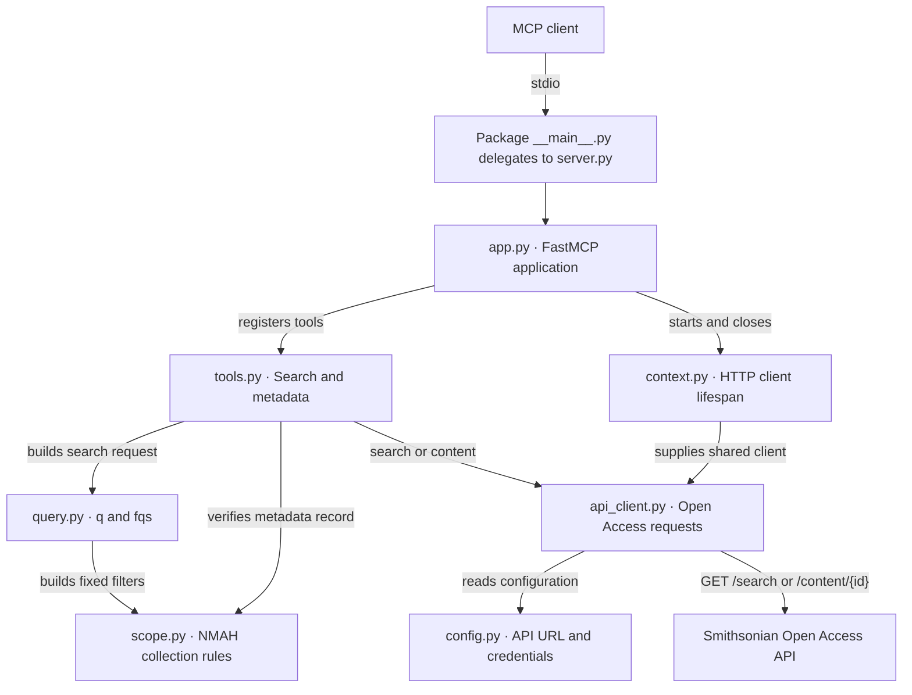

# NMAH MCP 模块架构与重构验证

[English version](../en/architecture.md) · [README](../../README.md)

## 模块架构

MCP 客户端通过 stdio 调用搜索和单件元数据工具。项目使用 `src` 布局，安装后运行 `python -m nmah_military_collection_mcp`。包内的 [server.py](../../src/nmah_military_collection_mcp/server.py) 提供启动函数，也供 FastMCP Inspect 加载。



| 模块 | 职责 |
| --- | --- |
| [app.py](../../src/nmah_military_collection_mcp/app.py) | 创建 FastMCP 应用，设置 instructions 并注册 MCP 工具。 |
| [context.py](../../src/nmah_military_collection_mcp/context.py) | 为每个应用生命周期创建一个共享 HTTP 客户端，退出时关闭。 |
| [tools.py](../../src/nmah_military_collection_mcp/tools.py) | 定义工具名称、参数和返回值，安排查询或详情调用，将内部异常转换为工具错误。 |
| [query.py](../../src/nmah_military_collection_mcp/query.py) | 将关键词、军种、年代和图片选项转换为检索请求。 |
| [scope.py](../../src/nmah_military_collection_mcp/scope.py) | 统一定义馆别、记录类型和 Set Name 前缀，供查询过滤与详情核验共用。 |
| [api_client.py](../../src/nmah_military_collection_mcp/api_client.py) 与 [config.py](../../src/nmah_military_collection_mcp/config.py) | 编码请求，按需从环境读取密钥，通过 `X-Api-Key` 发送认证，校验 HTTP 和 API 响应。 |
| [models.py](../../src/nmah_military_collection_mcp/models.py) 与 [errors.py](../../src/nmah_military_collection_mcp/errors.py) | 定义参数类型、内部搜索请求和分页结果，以及 API 和馆藏范围错误。 |

## 搜索工具调用流程

向 `search_nmah_military_objects` 传入关键词和筛选参数。以下是实测第一页的输入。

```json
{
  "branch": "Army",
  "date": "1910s",
  "has_images": true,
  "rows": 3,
  "offset": 0
}
```

1. 工具校验参数，`query.py` 把空关键词转换为 `q=*`。固定 `fqs` 包含 `unit_code:NMAH`、`type:edanmdm` 和 `Military and Society: Armed Forces History` 的 Set Name 前缀。军种别名、索引年代和 `online_media_type:Images` 按选项添加。
2. API 客户端把筛选序列化为一个 JSON 数组字符串，发送 `GET /search`。请求使用 `rows`、`start=offset` 和 `sort=id`。
3. 工具把 API 的 `rowCount` 和原始 `rows` 放入 `total_count` 和 `objects`，并返回 `applied_query`、`applied_filters`、分页字段和检索选项。翻页时沿用原参数，把 `next_offset` 传回 `offset`。末页的 `next_offset` 为 `null`。

## 元数据工具调用流程

向 `get_nmah_military_object_metadata` 传入搜索记录的 `content.descriptiveNonRepeating.record_ID`。

```json
{
  "record_id": "nmah_463569"
}
```

1. 工具校验 `nmah_<digits>` 形式的编号。API 客户端以 `edanmdm:<record_id>` 作为编码后的路径段调用 `GET /content/{id}`。
2. 响应通过 HTTP 和 API 状态检查后，`scope.py` 核对返回编号、外层 `unitCode` 和内层 `unit_code`、`edanmdm` 记录类型，以及至少一个符合 Armed Forces History 前缀的 `freetext.setName[].content`。
3. 核验通过后返回完整的 API `response` 记录。缺失、越界或无法核验的记录会产生工具错误。图片筛选只影响搜索，元数据以馆方响应为准。参见[有图字段与媒体核验](smithsonian-api-and-media.md)。

## 验证结果

以下是 **2026-11-08 模块化重构验收**的实测记录。命中数量随馆方索引变化。

| 检查 | 结果 |
| --- | --- |
| stdio 接口兼容 | 当时的根目录入口与包入口的工具发现结果均匹配重构前快照，包括两个工具名称、输入和输出 schema、annotations 与 instructions。FastMCP Inspect 通过。 |
| 离线测试 | 3 项测试通过，覆盖军种别名、搜索参数、共享客户端关闭、详情范围与上游异常。stdio smoke 通过 9 组无效输入和缺少密钥时的发现与调用检查。 |
| 真实搜索 | 陆军、1910 年代、有图、`q=*` 的查询命中 **2,535** 条。以 `offset=0` 和 `offset=3` 分两页取样，共 6 条且无重复。MCP 与直接 API 调用的总数、记录内容和顺序一致，两页合并与单次取 6 条一致。另核对了 `nmah_400783` 的有图查询。 |
| 真实元数据 | `nmah_463569` 通过范围核验，MCP 返回记录与直接请求 `/content` 的 `response` 逐字段一致。 |

从项目根目录运行以下命令复查。真实测试使用 `.env` 中的 `SMITHSONIAN_API_KEY`。

```sh
uv run --locked fastmcp inspect src/nmah_military_collection_mcp/server.py --format mcp
uv run --locked python -m unittest discover -s tests
uv run --locked python tests/smoke.py
uv run --locked --env-file .env python tests/smoke.py --live
```

验证入口见 [tests/smoke.py](../../tests/smoke.py) 和 [tests](../../tests)。
